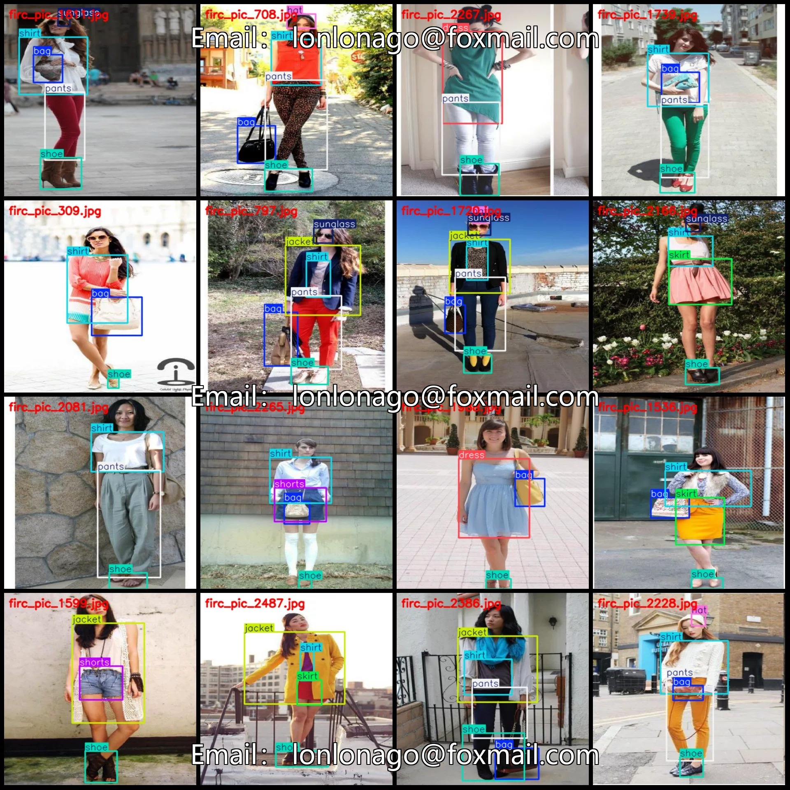
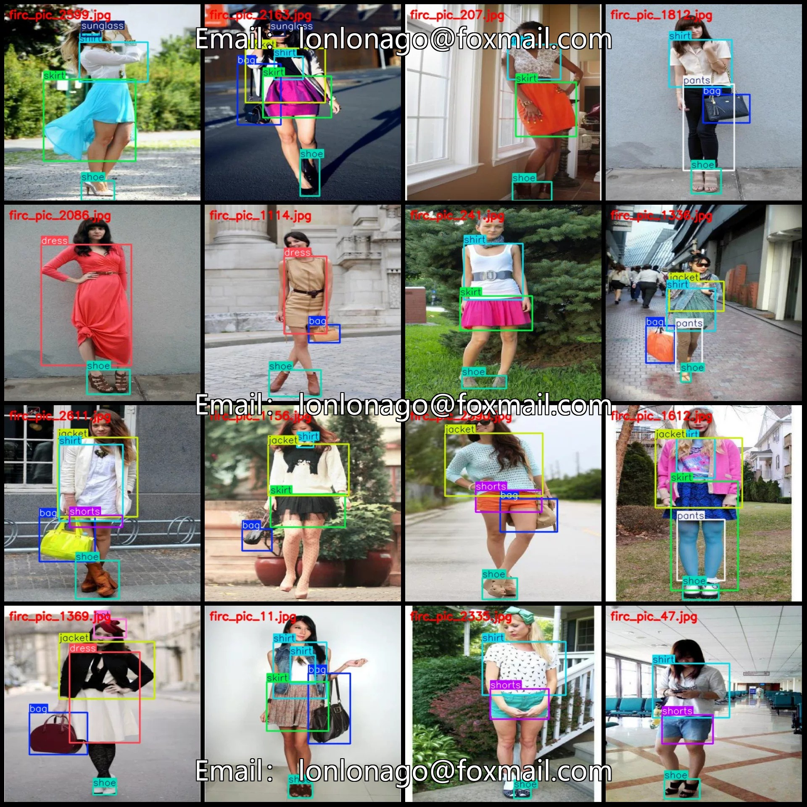
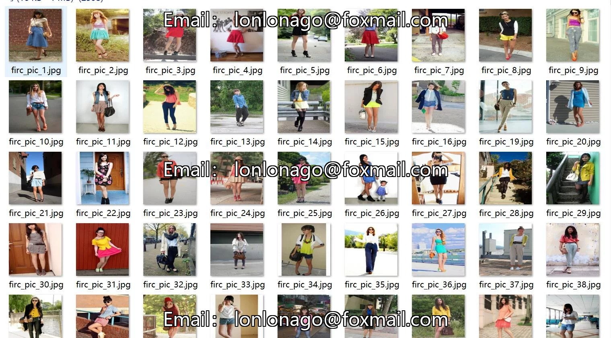
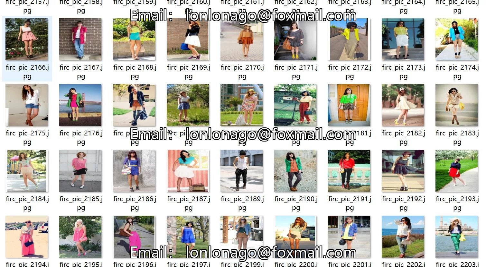
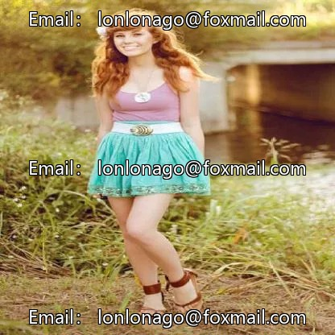
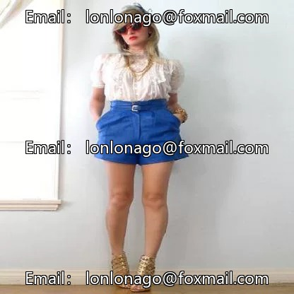
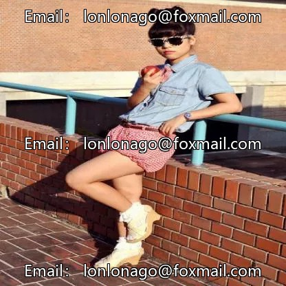

# Clothing Category Identification Detection Dataset VOC+YOLO format with 2682 images in 10 categories

## Body

Clothing Category Identification and Detection Dataset VOC+YOLO format: 2682 images in 10 categories
Tips: Due to the dataset's replicability, please confirm compliance with requirements before purchasing.
Dataset format: Pascal VOC format + YOLO format (txt file without split path, only containing jpg images and corresponding VOC format xml files and yolo format txt files)
Number of images (number of jpg files): 2682
Number of annotations (number of xml files): 2682
Number of annotations (number of txt files): 2682
Number of annotation categories: 10

Label category names (Note that the order of yolo format categories does not correspond to this, but is based on the classes.txt in the labels folder): ["bag", "dress", "hat", "jacket", "pants", "shirt", "shoe", "shorts", "skirt", "sunglass"]
The number of bounding boxes and image counts for each category:
- bag (bag) Bounding box count = 1462, Image count = 1462
- dress (dress) Bounding box count = 678, Image count = 678
- hat (hat) Bounding box count = 350, Image count = 350

Jacket (jacket) Frames = 958, Image Count = 944
Pants (Pants) Frames = 622, Pictures = 622
Shirt (shirt) Frames = 1852, Pictures = 1822
Shoe (Footwear) Frame Count = 2601, Image Count = 2601
Shorts (briefs) Frame Count = 502, Image Count = 502
Skirt (skirt) Frame count = 883, Image count = 883
Sunglasses (sunglasses) Frames = 425, Pictures = 425
Total frames: 10333
Image resolution: 416x416

Using labeling tool: labelImg
Labeling rules: Draw a rectangle around the category.
Important note: The dataset does not have separate training, validation, and test sets; you need to partition them yourself.
Special statement: This dataset does not guarantee the accuracy of the trained models or weight files.

## Images

## Payment

Here is a pay link on Stripe ( https://buy.stripe.com/3cs8yP7sY87d0vu9AB ). Please contact me lonlonago@foxmail.com after funding $89, and I will send you a complete data files , thank you!

